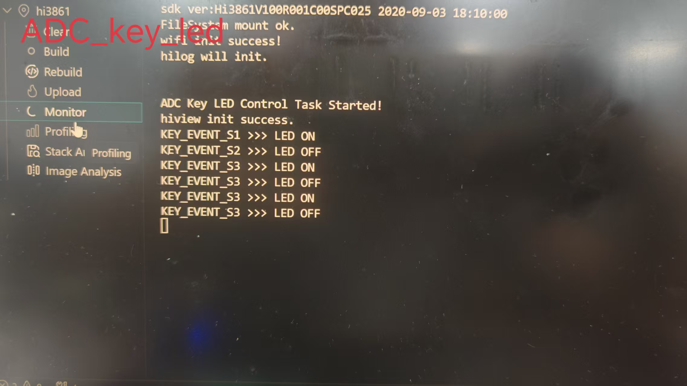
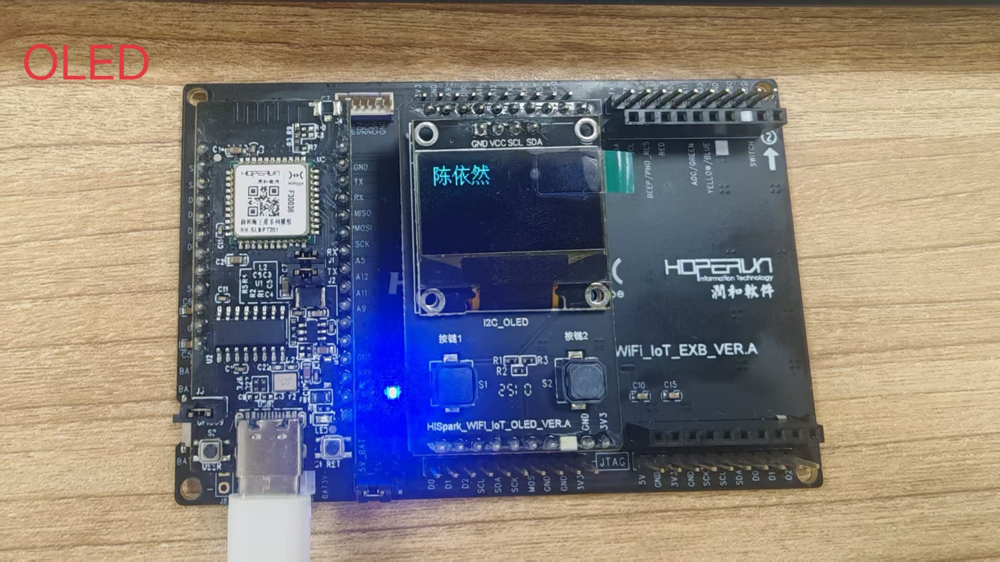
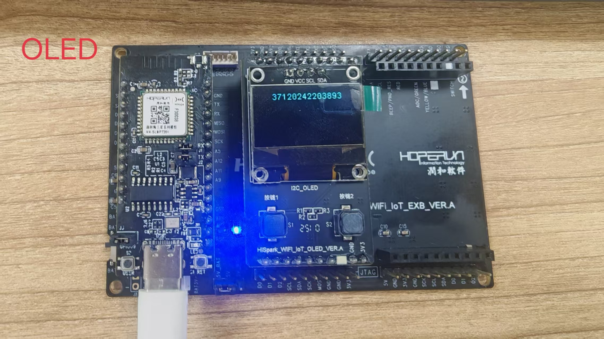
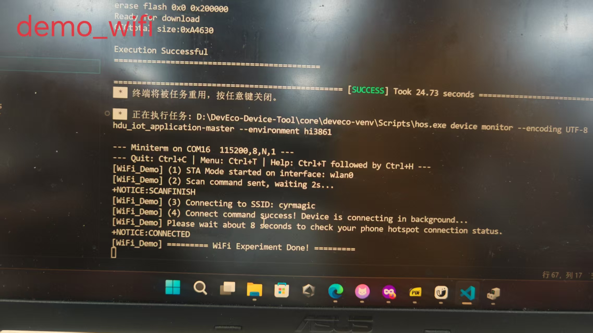

 <p align="center">
  <b>Hi3861 OpenHarmony 基础实验与 IoT 开发实践</b>
  <br>
  基于 HiSpark Pegasus · Hi3861V100 · OpenHarmony LiteOS-M 4.0
</p>

<p align="center">
  
  
  
  
  
  
</p>

## 1. 项目介绍

本项目是基于 Hi3861 WiFi IoT 开发套件完成的 OpenHarmony 基础实验与物联网开发实践，配套 2026 年电子工艺实训课程。

项目基于 OpenHarmony LiteOS-M 4.0 系统，使用 C 语言进行嵌入式应用开发，围绕 GPIO 外设控制、ADC 模拟信号采集、I2C 通信、OLED 显示、WiFi 无线联网及 MQTT 物联网通信展开。

通过一系列基础实验，逐步实现从底层外设控制到无线网络连接，再到端云消息交互的完整实践过程。

**主要实验内容：**

- GPIO：LED 闪烁、按键输入与 LED 控制。
- ADC：基于电压分压的多按键识别。
- I2C：SSD1306 OLED 显示驱动。
- WiFi：Station 模式、热点扫描、无线连接及 DHCP 获取 IP。
- MQTT：连接 Broker，实现消息订阅与发布。

仓库包含实验源码、配套实验报告、硬件实拍照片及串口运行日志，便于学习、复现和后续扩展。

## 2. Hardware & Development Environment

| 类别 | 配置 |
|---|---|
| 开发板 | HiSpark Pegasus Hi3861V100 WiFi IoT 开发板 |
| 主控芯片 | Hi3861V100 |
| 操作系统 | OpenHarmony LiteOS-M 4.0 |
| 编程语言 | C |
| 编译工具 | hb build |
| 烧录工具 | HiBurn |
| 调试工具 | 串口 Monitor |
| 通信方式 | GPIO / ADC / I2C / WiFi / MQTT |

## 3. Project Structure

```text
hi3861-oh-demos/
│
├── demos/
│   ├── 01_gpio_led/
│   │
│   ├── 02_adc_multi_key/
│   │
│   ├── 03_ssd1306_oled/
│   │   └── ssd1306/
│   │
│   ├── 04_wifi_sta/
│   │   └── demo_wifi/
│   │
│   └── 05_mqtt_client/
│       └── mqtt_test/
│
├── docs/
│   │
│   ├── hardware_pic/
│   │   ├── adc_monitor.jpg
│   │   ├── mqtt_log1.jpg
│   │   ├── mqtt_log2.jpg
│   │   ├── oled_screen1.jpg
│   │   ├── oled_screen2.jpg
│   │   └── wifi_log.jpg
│   │
│   ├── 29组_陈依然_37120242203893_电子工艺实验报告.docx
│   │
│   └── 开源鸿蒙小车环境搭建及快速入门_副本.pptx
│
├── README.md
└── root_BUILD.gn
```

各实验采用独立目录组织，便于分别启用、编译和调试。

## 4. 实验内容

### 4.1 GPIO 实验：LED 与按键控制

**目录：** `demos/01_gpio_led/`

**实验一：LED 周期闪烁**

- 使用 GPIO9 作为 LED 控制输出。
- 周期性翻转 GPIO 输出电平。
- 设置 300ms 时间间隔，实现 LED 周期闪烁。

**实验二：按键控制 LED**

- 使用 GPIO5 配置按键输入。
- 启用内部上拉输入。
- 按键按下时点亮 LED，松开时熄灭 LED。

**涉及技术：** GPIO 输入输出配置、数字电平控制、按键输入处理。

### 4.2 ADC 分压多按键实验

**目录：** `demos/02_adc_multi_key/`

通过 ADC2 通道读取模拟电压，根据不同按键对应的分压电压区间，识别 S1、S2、S3 三个独立按键。

**实验功能：**

- 使用 ADC2 采集模拟电压。
- 根据采样结果区分三个按键。
- 不同按键分别控制 LED 亮灭或状态翻转。

**实验意义：**

利用电阻分压和 ADC 采样，实现单个模拟输入引脚对多个按键的识别，减少 GPIO 引脚资源占用。

**硬件验证记录：**



### 4.3 SSD1306 I2C OLED 显示实验

**目录：** `demos/03_ssd1306_oled/ssd1306/`

使用 I2C0 驱动 0.96 英寸 SSD1306 OLED 显示屏。

**硬件接口：**

| 信号 | GPIO |
|---|---|
| SDA | GPIO13 |
| SCL | GPIO14 |

**实验功能：**

- OLED 显示 OpenHarmony 英文标语。
- 使用 16×16 汉字字模显示姓名「陈依然」。
- 显示学号 `37120242203893`。

**涉及技术：** I2C 通信协议、OLED 驱动、汉字字模显示、显示数据写入。

**硬件运行效果：**

<p align="center">
  
  
</p>

### 4.4 WiFi STA 无线联网实验

**目录：** `demos/04_wifi_sta/demo_wifi/`

实现 Hi3861 开发板以 Station 模式接入无线网络。

**实验流程：**

1. 配置 WiFi 工作模式为 Station。
2. 扫描周边可用 WiFi 网络。
3. 连接指定无线热点 `cyrmagic`。
4. 通过 DHCP 自动获取 IP 地址。

**涉及技术：** WiFi STA 模式、无线网络扫描、网络连接、DHCP。

**串口运行日志：**



### 4.5 MQTT 物联网通信实验

**目录：** `demos/05_mqtt_client/mqtt_test/`

在 WiFi 联网基础上，实现 Hi3861 开发板与 MQTT Broker 之间的消息通信，完成基础端云交互。

**通信流程：**

```text
Hi3861 Development Board
          │
          ▼
       WiFi STA
          │
          ▼
      DHCP 获取 IP
          │
          ▼
      MQTT Broker
          │
     ┌────┴────┐
     ▼         ▼
 Subscribe  Publish
     │         │
  name 主题   ID 主题
     │         │
 接收云端消息  上传本地学号
```

**实验功能：**

- 连接 WiFi 并获取网络 IP。
- 连接 MQTT Broker。
- 订阅 `name` 主题，接收云端下发消息。
- 发布 `ID` 主题，上传本地学号。

**涉及技术：** WiFi 网络连接、MQTT 客户端、主题订阅、消息发布、端云通信。

**串口运行日志：**

<p align="center">
  
  
</p>

## 5. 快速编译与使用

### 5.1 环境准备

准备 OpenHarmony 源码环境，并配置对应的 Hi3861 开发板编译环境。

### 5.2 导入项目

将本仓库代码放入 OpenHarmony 源码目录：

```bash
applications/sample/wifi-iot/app/
```

### 5.3 配置实验

根据需要修改工程顶层 `BUILD.gn`，启用需要编译的 Demo，关闭暂时不需要编译的实验。

仓库同时提供 `root_BUILD.gn`，可作为实验工程构建配置的参考。

### 5.4 选择开发板

在 OpenHarmony 源码根目录执行：

```bash
hb set
```

选择目标开发板：

```text
wifiiot_hispark_pegasus
```

### 5.5 编译工程

执行全量编译：

```bash
hb build -f
```

### 5.6 烧录与调试

1. 使用 HiBurn 烧录生成的固件镜像。
2. 连接开发板串口。
3. 使用串口 Monitor 查看运行日志。
4. 根据对应实验观察硬件运行现象。

## 6. 配套文档与实验记录

仓库提供电子工艺实训相关资料，用于记录实验过程和验证结果。

| 文件 | 内容 |
|---|---|
| `29组_陈依然_37120242203893_电子工艺实验报告.docx` | 完整电子工艺实训报告 |
| `开源鸿蒙小车环境搭建及快速入门_副本.pptx` | OpenHarmony 小车环境搭建及入门资料 |
| `docs/hardware_pic/` | 硬件实拍与串口日志截图 |

实验报告主要包含：

- OpenHarmony 系统相关理论知识。
- 各项基础实验的设计与代码。
- 实验现象及结果分析。
- OpenHarmony 小车拓展内容。

## 7. 关联项目

**hi3861-oh-smart-car**

基于 Hi3861 和 OpenHarmony 的综合循迹遥控智能小车项目。

本仓库主要记录 Hi3861 基础外设、无线网络及 MQTT 通信实验；关联仓库进一步拓展到智能小车应用。

## 8. 技术积累

通过本次实验，主要实践了以下技术：

- **OpenHarmony LiteOS-M：** 熟悉 OpenHarmony WiFi IoT 开发环境及基础应用开发流程。
- **GPIO：** 掌握数字输入输出及 LED、按键控制。
- **ADC：** 理解模拟信号采样与电压分压识别。
- **I2C：** 掌握 I2C 外设通信及 SSD1306 OLED 驱动。
- **WiFi：** 实现 Station 模式无线连接及 DHCP 获取 IP。
- **MQTT：** 实现客户端连接、主题订阅与消息发布。
- **嵌入式调试：** 通过串口日志和硬件现象验证程序运行状态。

## 9. License

This project is licensed under the MIT License.

---

<p align="center">
  <b>Author: Still</b>
  <br>
  OpenHarmony · Hi3861 · IoT Development
</p>
